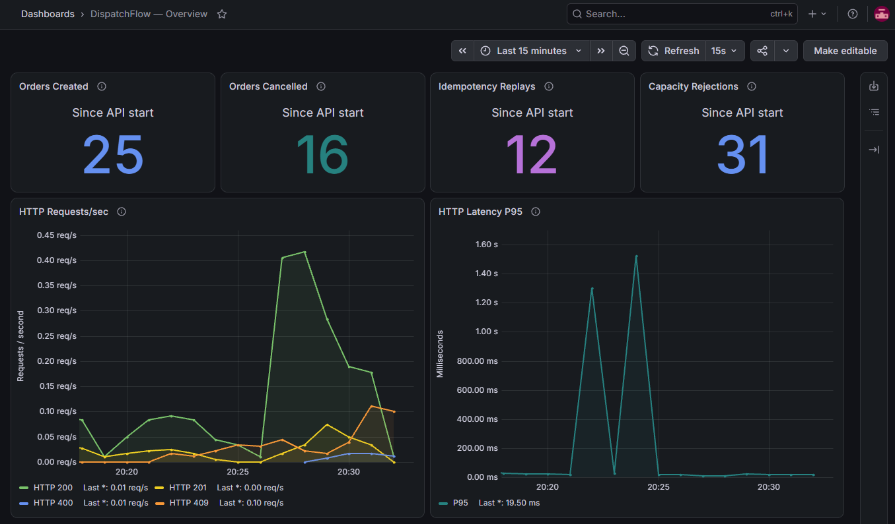

# DispatchFlow

[](https://github.com/LeonMalakov/Dispatch-Flow/actions/workflows/ci.yml)

**A .NET 10 backend API for delivery-slot reservations and order lifecycle management.**

DispatchFlow is a pet project focused on the parts of order processing that become difficult under concurrency: preventing overbooking, handling retried requests without duplicates, and cancelling orders without releasing the same capacity twice. It uses ASP.NET Core, EF Core, and PostgreSQL, with integration tests against a real database.

## Highlights

- **Concurrency-safe reservations.** Conditional database updates ensure that concurrent orders cannot reserve more than a delivery slot's capacity.
- **Idempotent order creation.** An optional `Idempotency-Key` header lets clients safely retry requests. A unique PostgreSQL index resolves races between requests using the same key.
- **Atomic cancellation.** Cancelling an order changes its status and releases its reservation in one transaction. Repeated or concurrent cancellation never releases capacity twice.
- **Transactional consistency.** Failed operations roll back their changes, including order records, reservations, and idempotency keys.
- **Database-backed testing.** Integration tests exercise HTTP endpoints, actual PostgreSQL locks, transaction commit/rollback races, and failure recovery using Testcontainers.
- **Observability.** Health checks, OpenTelemetry traces and metrics, structured application logs, and a provisioned Grafana dashboard for inspecting API performance and order outcomes.

## Tech stack

**C# · .NET 10 · ASP.NET Core Web API · EF Core · PostgreSQL · OpenTelemetry · Grafana (Loki, Tempo, Prometheus) · Docker Compose · Testcontainers · xUnit · NSubstitute · GitHub Actions**

## Architecture

```text
src/
  DispatchFlow.Api/              HTTP endpoints and API contracts
  DispatchFlow.Application/      Order workflows, models, and repository interfaces
  DispatchFlow.Infrastructure/   PostgreSQL persistence, EF Core mappings, migrations

tests/
  DispatchFlow.UnitTests/        Model and application behavior
  DispatchFlow.IntegrationTests/ HTTP and persistence tests with PostgreSQL

observability/
  grafana/                     Dashboard JSON and automatic provisioning
```

The API calls application services through a repository interface; Infrastructure provides its EF Core implementation.

### Reliability under concurrency

Capacity is reserved through a conditional PostgreSQL `UPDATE` that succeeds only when enough capacity remains. Cancellation uses another conditional update to transition an order from `Created` to `Cancelled`; only the request that performs that transition may release the reservation. Both changes happen in a `ReadCommitted` transaction.

For keyed creation, the order is inserted *before* capacity is reserved. The unique index on `IdempotencyKey` serializes competing requests for the same key. A request that loses the race returns the existing order (or a conflict if the payload differs), instead of incorrectly reporting insufficient capacity. An unsuccessful creation does not consume the key.

## API

| Method | Endpoint | Description |
| --- | --- | --- |
| `POST` | `/api/orders` | Create an order and reserve slot capacity |
| `GET` | `/api/orders/{id}` | Retrieve an order |
| `POST` | `/api/orders/{id}/cancel` | Cancel an order and release its reservation |

### Create an order

```http
POST /api/orders
Content-Type: application/json
Idempotency-Key: demo-order-001

{
  "slotId": "d1010000-0000-0000-0000-000000000001",
  "quantity": 2
}
```

The `Idempotency-Key` header is optional, case-sensitive, and accepts 1–128 characters: letters, digits, `-`, `_`, `.`, and `:`.

| Result | HTTP status |
| --- | --- |
| New order created | `201 Created` |
| Same key, same slot and quantity | `200 OK` with the existing order |
| Same key, different slot or quantity | `409 Conflict` |
| Slot does not exist | `404 Not Found` |
| Insufficient slot capacity | `409 Conflict` |
| Invalid request or idempotency key | `400 Bad Request` |

A successful response contains the order's `id`, `slotId`, `quantity`, `status`, and `createdAtUtc`.

### Cancel an order

```http
POST /api/orders/{id}/cancel
```

Both the first cancellation and subsequent cancellations return `200 OK` with status `Cancelled`; a missing order returns `404 Not Found`. Retrying the original creation request with the same idempotency key **after cancellation** returns the existing `Cancelled` order without reserving capacity again.

## Run locally

**Requirements:** .NET 10 SDK, Docker.

From the repository root:

1. Create .env from .env.example, set POSTGRES_PASSWORD, and start PostgreSQL:

   ```
   docker compose up -d postgres
   ```

2. Configure ConnectionStrings__DispatchFlow using the same credentials, then apply migrations:

   ```
   $env:ConnectionStrings__DispatchFlow = "Host=localhost;Port=5432;Database=dispatchflow;Username=dispatchflow;Password=YOUR_PASSWORD"
   dotnet tool restore
   dotnet ef database update --project src/DispatchFlow.Infrastructure --startup-project src/DispatchFlow.Api
   ```

3. Enable development seed data and start the API:

   ```
   $env:Development__SeedData = "true"
   dotnet run --project src/DispatchFlow.Api --launch-profile http
   ```

   API: http://localhost:5109
   OpenAPI (Development): http://localhost:5109/openapi/v1.json

The optional development seed adds two slots with stable IDs (if they do not already exist):

| Slot | ID | Capacity |
| --- | --- | ---: |
| Morning | `d1010000-0000-0000-0000-000000000001` | 20 |
| Afternoon | `d1010000-0000-0000-0000-000000000002` | 30 |

There is currently no HTTP endpoint for creating delivery slots; the seed data is intended for trying out the order API. The seeder is disabled by default, and migrations must be applied before enabling it.

## Observability

DispatchFlow includes optional local diagnostics with **OpenTelemetry** and **Grafana LGTM**. OpenTelemetry instruments incoming ASP.NET Core requests and Npgsql database operations, collects HTTP and order metrics, and exports structured `ILogger` records. The LGTM container runs an OpenTelemetry Collector alongside **Tempo** (traces), **Prometheus** (metrics), **Loki** (logs), and **Grafana** (visualization).

- **Health checks:** `GET /health/live` returns `200` while the API is responsive; `GET /health/ready` checks PostgreSQL connectivity and returns `503` if the database is unreachable.
- **Distributed tracing:** HTTP requests and their nested PostgreSQL operations are correlated in Tempo. Npgsql tracing is configured to omit SQL query text and use a fixed diagnostic data-source name.
- **Structured logs:** Application events for order creation, cancellation, idempotent replays, and insufficient capacity can be investigated in Loki alongside HTTP traces.
- **Business metrics:** Counters track successful creations, cancellations, idempotent replays, and capacity rejections. They are recorded after repository operations complete and are intended for monitoring, not as a durable order ledger.

### Grafana dashboard



The automatically provisioned **DispatchFlow — Overview** dashboard shows four order counters, HTTP requests per second grouped by status, and HTTP latency P95.

### Enable local diagnostics (optional)

Start PostgreSQL and Grafana LGTM:

```
docker compose --profile observability up -d
```

Before starting the API, enable OTLP/HTTP export:

```
$env:OTEL_EXPORTER_OTLP_ENDPOINT = "http://localhost:4318"
dotnet run --project src/DispatchFlow.Api --launch-profile http
```

Grafana: http://localhost:3000

## Tests & CI

Run the full test suite from the repository root (Docker must be running for integration tests):

```
dotnet test DispatchFlow.slnx -c Release
```

Unit tests cover model validation and application behavior. Integration tests use **Testcontainers for PostgreSQL** to check real database constraints, transaction rollback, concurrent creation and cancellation, idempotency races, and safe HTTP error responses.

[GitHub Actions CI](https://github.com/LeonMalakov/Dispatch-Flow/actions/workflows/ci.yml) restores dependencies, builds the solution in `Release`, and runs both test projects for pull requests and changes to `main`.
